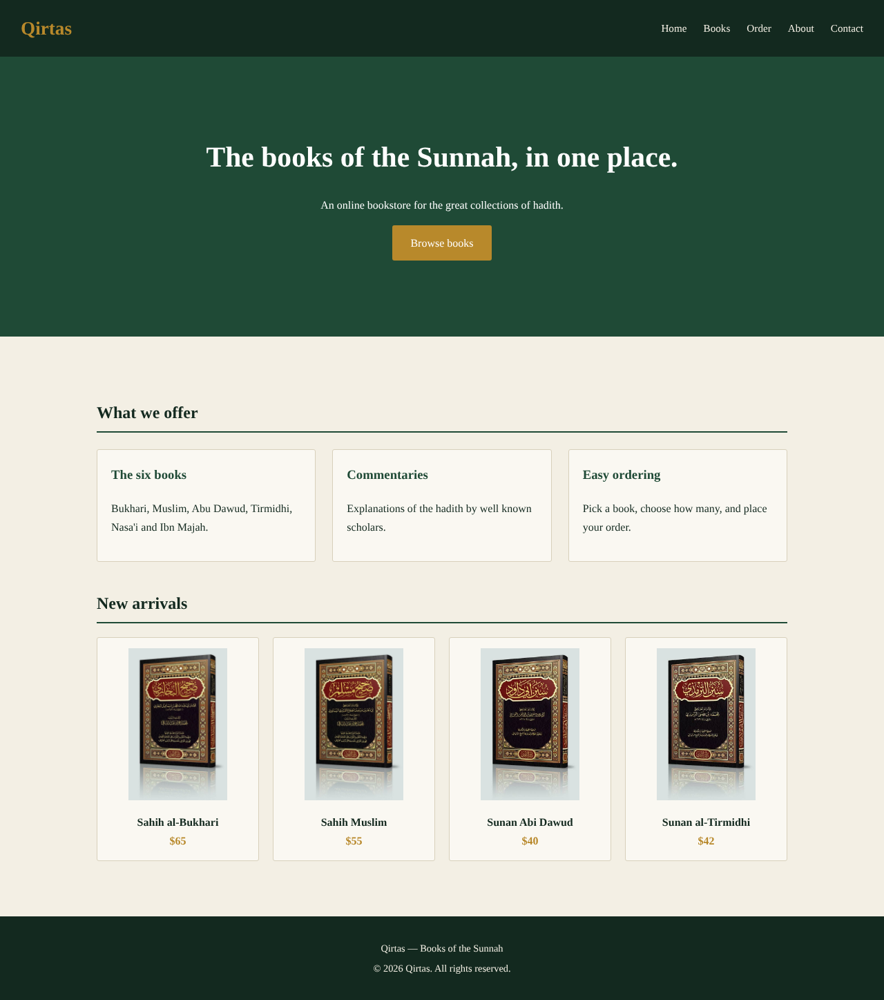
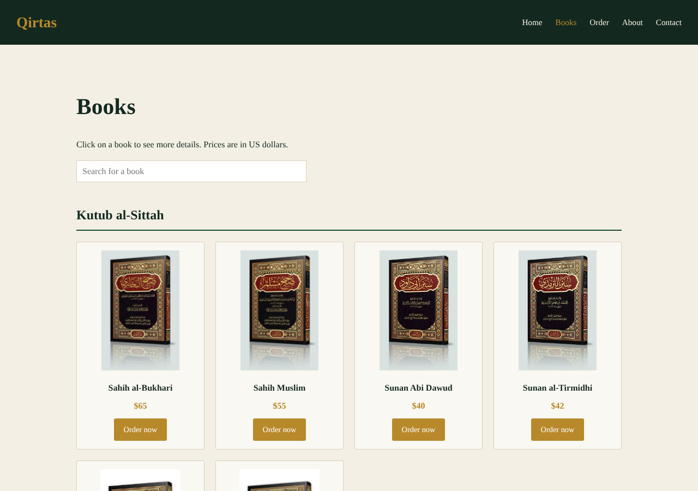
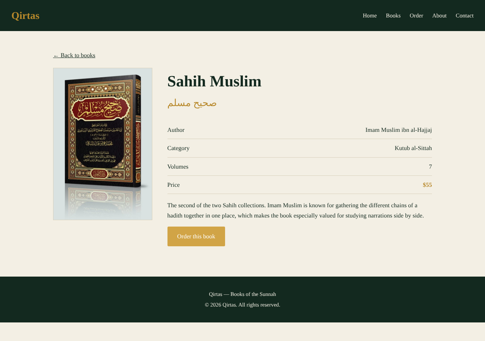
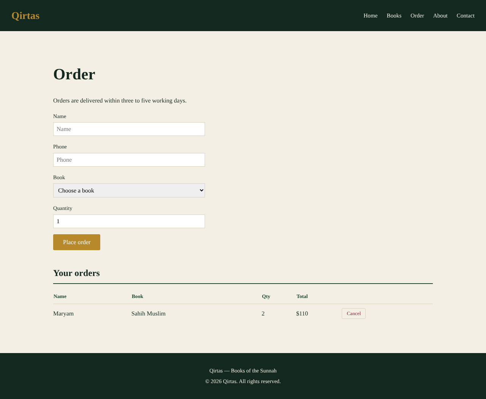
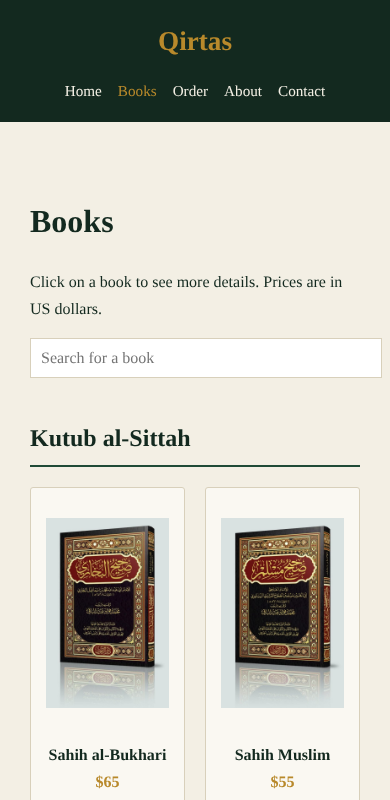

# Qirtas

Qirtas is an online bookstore website for Islamic books like Sahih al-Bukhari, Sahih Muslim, Musnad Imam Ahmad and more. You can look at the books, search for a book, open each book to see its details, and place an order.

This is my project for CSCI426 Advanced Web Programming (Phase 1).

Made by: Ahmad Thraya

## Pages

- Home
- Books (Services)
- Book details (dynamic page, changes depending on the book you click)
- Order
- About
- Contact

## Built with

- React
- React Router
- CSS

## How to run it

```
npm install
npm start
```

Then open http://localhost:3000

## Screenshots







## Live link

<your-vercel-link>

